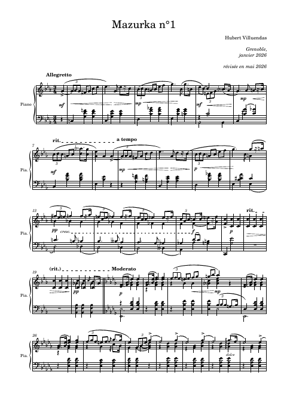
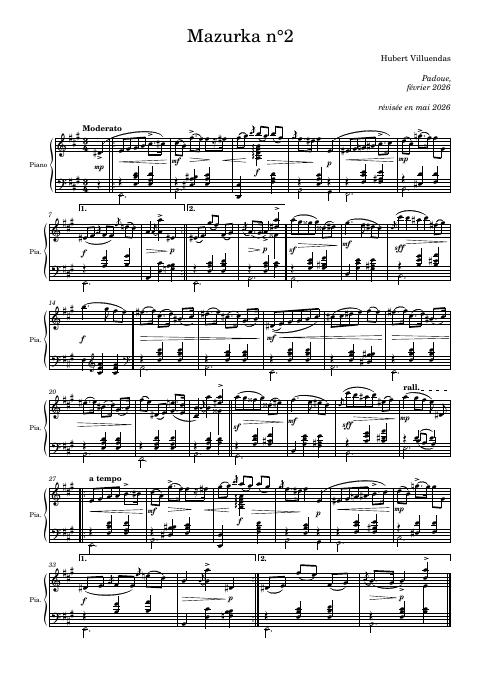



Outside of research, I also write music, aiming for the style of classical composers.


  Ajoute tes morceaux ici. Exemples d'intégration (copie le code "Embed" / "Intégrer"
  fourni par la plateforme et colle-le à la place) :

  SoundCloud :
  <iframe width="100%" height="166" scrolling="no" frameborder="no" allow="autoplay"
    src="https://w.soundcloud.com/player/?url=https%3A//api.soundcloud.com/tracks/TRACK_ID&color=%23ff5500"></iframe>

  YouTube :
  <iframe width="100%" height="315" src="https://www.youtube.com/embed/VIDEO_ID"
    title="YouTube video player" frameborder="0" allowfullscreen></iframe>

  Spotify :
  <iframe style="border-radius:12px" width="100%" height="152" frameborder="0"
    src="https://open.spotify.com/embed/track/TRACK_ID" allow="encrypted-media"></iframe>

  Fichier audio hébergé sur le site (mettre le fichier dans /files/misc/) :
  <audio controls src="{{ base_path }}/files/misc/mon-morceau.mp3"></audio>

  Aperçu d'une nouvelle partition (première page en PNG, à lancer depuis le dossier du site) :
  pdftoppm -png -gray -f 1 -l 1 -scale-to-x 480 -scale-to-y -1 -singlefile "files/misc/Ma partition.pdf" images/misc/ma-partition
  puis copier un bloc 
…
 ci-dessous et adapter les liens (espaces → %20).


The two mazurkas below were written in the style of Chopin's mazurkas.

  

    
    

      
<strong>Mazurka n°1</strong>, for piano

      
Grenoble, January 2026, revised May 2026

      
<a href="/files/misc/Hubert%20Villuendas%20-%20Mazurka%20no%201.pdf">Score (PDF)</a>

    

  

  

    
    

      
<strong>Mazurka n°2</strong>, for piano

      
Padua, February 2026, revised May 2026

      
<a href="/files/misc/Hubert%20Villuendas%20-%20Mazurka%20no%202.pdf">Score (PDF)</a>

    

  

